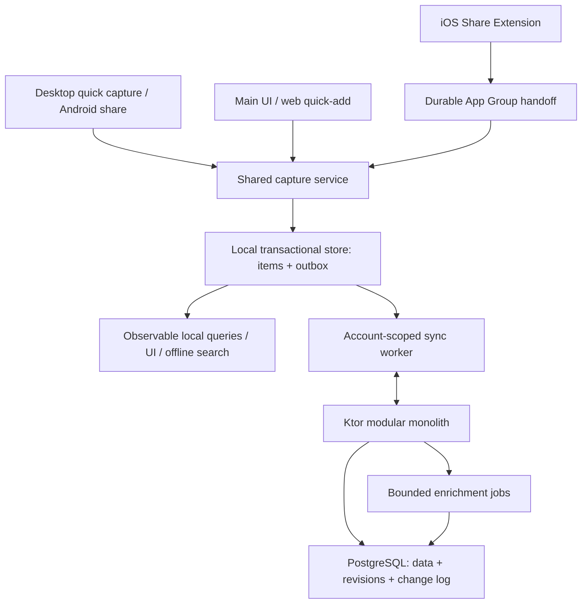

# Stash architecture decisions

Status: proposed design · 2026-11-26 · no application exists yet.

The repository currently contains only `.gitignore`, AGENTS.md, PRODUCT_SPEC.md and CODEX_START.md. This is an evaluation of the proposed architecture, not a review of implemented code. Read the execution order in [development-plan.md](development-plan.md) and evidence in [compatibility.md](compatibility.md).

## 1. Share behavior; isolate platform ownership

Use Kotlin Multiplatform for capture rules, domain models, repository contracts and synchronization. Use Compose Multiplatform for the main adaptive UI if the platform probes pass. Native capture entry points must initialize only what capture needs. An iOS Share Extension must not start the full application or Compose UI to save content.

The iOS handoff is durable before extension success; ingestion into the app database may happen later. It must remain visible as pending handoff if necessary. Main-app capture succeeds only after its item/outbox transaction commits. The distinction is part of the API contract, not an optimistic success message.

Start with a small set of build modules: `shared` (domain/data/sync plus target adapters), `composeApp` (shared UI and desktop/web entry points), `androidApp` (Android application and share activity), native `iosApp` with extension target, and `server` when sync begins. Add a small `contracts` module with the API, not before it is useful. A database-only module is justified if it simplifies target dependencies/KSP. Other suggested spec directories begin as packages. Adapt names/source layouts to the selected build tool.

Platform dependencies point inward to shared contracts. Domain logic never imports Room, IndexedDB, Compose, Android, Apple or server persistence APIs. Keep DTOs and database rows separate where their ownership/versioning differs; avoid a generic repository framework.

## 2. Capture is a local transaction

`CaptureService.capture(CaptureRequest)` accepts original content, source and optional collection/tags/note. Its result identifies a durable item or an actionable failure; it must never imply remote synchronization. Type detection preserves the complete original string, including code whitespace and mixed text/links. Derived URL/type/category fields are additive. Invalid or unsupported URLs can remain notes; they must not trigger unsafe article fetching.

Persist client UUID, local profile/account partition, typed content, original input/URL, title, collection/tags/state, timestamps and an outbox mutation ID atomically. Server revision starts unset. Reuse a stable request/mutation ID for retry after an uncertain result; two intentional identical captures remain two items with a possible duplicate suggestion.

Metadata, network, classification, login refresh, reader extraction and sync scheduling follow persistence. Failure leaves the original available for retry. Explicit clipboard reads happen only on user action. Empty clipboard/permission failure must be actionable. Undo is a new durable state change and corresponding mutation, safe even if the create has already synchronized.

Use coroutine scopes owned by the application/account, screen, capture activity or extension session. Account switching cancels and joins old workers before opening another store. A screen closing must not cancel an acknowledged write. Cancellation during commit is reconciled by stable IDs on retry. Inject dispatchers/clocks where behavior requires them; keep blocking I/O off UI/event-loop threads.

## 3. Persistence remains behind one narrow contract

The logical contract is transactional item/outbox writes, query observation, migration and atomic pull/cursor application. Prefer Room KMP on Android/iOS/JVM. Compare current Room web support with a direct IndexedDB adapter before choosing; do not force a single storage engine for code-sharing percentages. [Room 3 release notes](https://developer.android.com/jetpack/androidx/releases/room3) document JS/Wasm targets but also worker integration responsibilities. SQLDelight is a fallback only if the probe demonstrates less total complexity.

Native SQLite settings must be measured for the durability/performance tradeoff; do not acknowledge before commit or enable destructive migration fallback. Browser writes must await whole-transaction completion, not an individual request callback. Keep database framework types out of capture contracts so a separate browser adapter does not duplicate business rules.

Use a native iOS App Group queue of versioned immutable capture envelopes as the initial handoff candidate. Coordinate cross-process publication and ingestion; use atomic file replacement plus a tested flush/durability procedure, not filename rename alone as proof. The extension returns success only after durable publication. Ingestion preserves the envelope UUID, commits item/outbox, then removes the envelope. Crashes replay safely. Quarantine malformed inputs without deleting them; do not redirect old-account captures to a newly signed-in account. Protect content with an appropriate Data Protection class. Verify entitlement, extension-safe APIs and locked-device behavior on device. Apple requires coordination of shared-container access; see [extension data sharing](https://developer.apple.com/library/archive/documentation/General/Conceptual/ExtensibilityPG/ExtensionScenarios.html).

Web storage has eviction, quota, private-mode and user-deletion limits. Request persistent storage when appropriate, communicate denial, retain failed input and provide export. An offline-first web app also needs an application-shell cache/service worker; IndexedDB alone cannot reopen the app without network. See [browser storage limits](https://developer.mozilla.org/en-US/docs/Web/API/Storage_API/Storage_quotas_and_eviction_criteria) and [IndexedDB transaction semantics](https://www.w3.org/TR/IndexedDB/).

## 4. Sync is an explicit protocol

Use one Ktor server and PostgreSQL, with Flyway as the schema authority and Exposed as the access layer. Keep JDBC transactions on a bounded blocking-I/O dispatcher and connection pool. Coroutine syntax does not make JDBC nonblocking; see [Exposed transactions](https://www.jetbrains.com/help/exposed/transactions.html). Pin Flyway's PostgreSQL support module with its core and JDBC driver; see [Flyway PostgreSQL setup](https://documentation.red-gate.com/flyway/reference/database-driver-reference/postgresql-database).

Push includes mutation ID, item ID, operation, base revision and payload. Server identity comes from authentication, never a trusted client owner field. Validate tenant and base revision; commit item, revision, idempotency result and change log in one transaction. Replayed mutation IDs return the same result; changed payload under the same ID is rejected. GET/item/content/search and remote capture use the same authorization rules.

Pull uses an opaque account-scoped cursor over a committed change order. Do not equate a PostgreSQL sequence allocation with commit order: a late transaction can otherwise be skipped. Begin with per-account serialization of change-order assignment within the transaction, then test simultaneous commits and pagination. Apply a page plus its cursor locally in one transaction; replay is safe. Pending local edits must not be overwritten blindly by pulled snapshots.

Proposed initial conflict policies, to freeze with fixtures before sync implementation:

| Conflict | Policy |
| --- | --- |
| Concurrent note/original-content edits | Preserve both versions with provenance and stable conflict identity; show resolution, never silently replace one. |
| Different scalar fields changed from the same base | Merge independently; same-field divergence returns a visible conflict. No client-clock last-write-wins. |
| Tags and membership | Merge independent tag operations; explicit add/remove conflict requires a tested server-order policy. Collections remain owner-scoped. |
| Delete/edit | Keep the tombstone; preserve the competing edit as recoverable content and surface it. Restore is explicit. |
| Enrichment vs user edits | Update server-owned derived fields only; never replace original content or a user title. |

Retain tombstones and idempotency records under a documented device/cursor retry policy. Expired cursors require a full resync that preserves unpushed edits and conflict copies; disable destructive cleanup until tested. Retry transient failures with bounded exponential backoff/jitter; authentication and permanent validation errors need distinct recovery. SSE is an optional wake-up hint; resume/reconnect always pulls.

Collections/tags and reading state require their own synchronized revisions or explicit operations; item-only sync is insufficient. Attachment upload/download has a later separate resumable lifecycle.

## 5. Platform and security boundaries

| Boundary | Proposed owner / limitation |
| --- | --- |
| Desktop capture | Native shortcut/tray/clipboard/window adapters behind narrow interfaces; probe macOS and Windows APIs and Linux/X11/Wayland separately. Configurable shortcuts, focus restoration and accessible failure fallback. The [GlobalShortcuts portal](https://flatpak.github.io/xdg-desktop-portal/docs/doc-org.freedesktop.portal.GlobalShortcuts.html) is a Wayland candidate, not proof of universal support or clipboard access. |
| Mobile capture | Android lightweight ACTION_SEND activity and iOS native extension. Later entry points reuse the capture contract; OS background execution is never required for acknowledgement. |
| Web | Wasm UI candidate, browser storage and clipboard adapter, offline shell and browser sessions. Test accessibility and browser history before sharing all navigation/UI. JS fallback only after a working probe. |
| Credentials/accounts | Native secure storage adapters, external-browser OAuth authorization code + PKCE through established libraries, and same-origin secure HttpOnly browser sessions with CSRF defenses. Offline profiles are separate from server identities; linking requires explicit association. [RFC 8252](https://www.rfc-editor.org/rfc/rfc8252.html) defines native-app OAuth guidance. |
| Reader/import/server | Bounded fetcher/extraction/cache adapters; tenant checks on every resource, SSRF defense across DNS/redirects, sanitized HTML/Markdown, TLS, limits and redacted logs. Import preview precedes writes; export includes local unsynced data. |

Server extraction jobs should live in the modular monolith with durable PostgreSQL job state and bounded workers. No Kafka/Redis/microservices/Kubernetes. PostgreSQL full-text search is sufficient initially; local search stays usable offline. S3-compatible storage begins with attachments. No mandatory AI or external application analytics.

## Decisions still open

1. **Build system:** Kotlin Toolchain CLI is an Alpha candidate; Gradle remains the baseline until 0A proves the complete workflow. Android CLI complements either choice. CLI/skills setup must not overwrite project requirements.
2. **Storage and web reach:** Room native/web versus Room native + IndexedDB, OS/CPU/browser minimums, Wayland behavior and a possible web fallback depend on probes. Scope reductions require discussion.
3. **Data policy:** E2EE is unresolved and conflicts with transparent server extraction/search; retention, guest-to-account linking and permanent deletion need explicit product decisions.
4. **Release:** private/self-hostable personal use first, tenant isolation from the first server endpoint. Commercial model and name/trademark clearance remain unresolved. No publishing authorized.

Record accepted/rejected options with evidence beside these decisions as each slice completes. Documentation support is not build verification.
